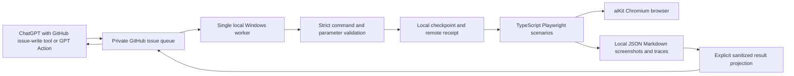

# aiKit local QA automation

Node.js 24 + the repository's locked Playwright 1.65 / TypeScript 5.9 dependencies drive a dedicated local Chromium browser. No AI SDK, cloud browser, credit purchase, public callback server or paid automation dependency is used.

The existing BEQSON tests/configuration remain separate. This directory extends the original aiKit bridge rather than changing the BEQSON production website.

## Start on Windows

1. Double-click `bridge/START-BRIDGE.cmd`. It checks Node, installs missing locked dependencies and Chromium, protects local evidence, validates private GitHub access, imports the official checklist, and starts polling.
2. For authenticated checks, stop the bridge and double-click `bridge/LOGIN-AIKIT.cmd`. Sign in manually in the dedicated browser. The script saves local auth state automatically. It does not ask for credentials in chat.
3. Run `node aikit/bridge/sync-program.mjs` once after login to reconcile the nine live cards. This only reads their checklists and report references; it never changes checkboxes or workflow stages.
4. Restart `START-BRIDGE.cmd`. Keep the PC awake. Ctrl+C stops the active browser process tree and bridge; queued tasks remain in GitHub.

Node itself must be installed if missing. GitHub access uses `GH_TOKEN` / `GITHUB_TOKEN`, existing GitHub CLI authentication, or Git Credential Manager, in that order. Credentials are read into memory only and never printed. If none exists, sign in locally through GitHub CLI or Git Credential Manager. GitHub CLI is optional on an already authenticated Git installation. The queue is fixed to **private** `Bequcho/beqson-qa-platform`, with actor **Bequcho**. Startup refuses a public queue or another account.

The permission helper supports PowerShell 7 and Windows PowerShell 5.1. It sets an access-only ACL for the current user, SYSTEM and administrators and verifies the result. Its execution-policy flag applies only to that helper process. It does not modify machine-wide PowerShell policy.

## Architecture



`lib/protocol.mjs` validates fixed commands and typed parameters. Issue text is never passed to a shell, evaluated, imported, or used as a file path or URL. Only the installed Playwright CLI and registered tests execute. `lib/worker.mjs` processes tasks sequentially, persists transitions atomically, deduplicates result comments, closes reported issues after restart, and converts interrupted work to a report without replaying browser actions. `lib/github.mjs` checks account/private-repository access and paginates the queue/comments. `lib/runner.mjs` creates a fresh run directory, bounds execution/output, interprets Playwright results, and saves local reports.

The bridge and test runner have separate exclusive locks. Stale-lock reclamation is serialized. A corrupt checkpoint fails closed. A remote claim prevents automatic replay if local receipts are lost. This is a **single-computer worker**, not a distributed queue: do not run independent bridge installations against the same repository. GitHub issue comments are not an atomic distributed lease. Back up the entire private local state before moving the bridge.

Polling backs off after errors. PAUSE/STOP are checked during execution about every five seconds, plus GitHub latency. Browser runs have hard time limits and bounded process logs. The bridge refuses new browser runs when local run evidence exceeds 2 GiB / 100,000 files or free space is below 1 GiB; archive locally by hand to preserve evidence. No automatic evidence deletion occurs. There is no promise that the site itself cannot allocate memory or initiate a download before the next external timeout.

## Evidence and security

Everything sensitive lives under ignored `.aikit-local/`:

| File/directory | Purpose |
|---|---|
| chrome-profile/ | Dedicated manual-login profile |
| auth-state.json | Cookies/local storage/IndexedDB used by auth checks |
| authorizations.json | Expiring, bounded local preference approvals |
| bridge-state.json | Task receipts, lifecycle and review pause |
| heartbeat.json | Last successful poll and pause state |
| checklist-source.json | Private historical source snapshot |
| checklist.json | 99 scenario definitions and persistent histories |
| program-history/ | Read-only live-card snapshots and private traces |
| reconciliation.json | Live/historical reconciliation metrics |
| runs/UUID/ | JSON/Markdown reports, process log, Playwright JSON, screenshots, traces |
| known-issues.json | Suspected findings, local drafts, regression/retest history |
| latest.json | Latest test execution reference |

Full browser errors, account/project names, URLs, screenshots, traces and bug drafts are never sent to GitHub by the worker. Its publication contains only registered command identifiers, run IDs, counters, known reason codes and progress metrics. The public workflow uploads no browser artifacts. `npm run aikit:check-public` checks publishable paths and supported token/key patterns; it is a useful check, not proof against every possible secret format.

Public tests use fresh signed-out browser contexts. State-changing HTTP methods are blocked, except the exact `POST https://aikit.ai/api/me/language` endpoint when the user has given a bounded local language-preference approval. Authenticated checks block all writes. Project creation/edit/publish/delete, uploads to authenticated tools, account changes, AI generation and token consumption have no queue-executable drivers. They remain blocked until a specific driver, designated test object, and explicit authorization are provided. A GitHub issue cannot grant those permissions.

## Test scope and honest progress

`tests/*.ts` verifies public home response and selected locale, actual Tools navigation and Back, language switching/reload when approved, mobile overflow/menu/navigation, uncaught JavaScript errors, and protected project-page access. Traces and screenshots are local for both passing and failing tests. `tests/utilities.ts` supplies bounded synthetic file fixtures, form-error checks, and download extension/size/magic verification; these helpers do not claim any real aiKit upload/download workflow has been executed. Mobile checks use a 375×812 viewport; they are not real-device validation.

Every test must execute its assertions to PASS. Skips become BLOCKED or NOT TESTED, and cases not reached after the first failure remain NOT TESTED. Failures are **suspected** until reproduced and checked against existing reports. The queue pauses on the first failed workflow; confirm review before resuming potentially affected scenarios. No bug is automatically submitted to aiKit.

The official checklist has nine categories and 99 items. The importer requires exact counts, order and uniqueness. Each local scenario includes the original objective/expected result, prerequisites, synthetic data, steps, actual behavior, status, evidence, known-report references, retest requirements and append-preserved history. Live UI checkmarks, historical dispositions, and newly verified results are separate fields. Source refreshes do not overwrite existing results. Read-only smoke results never complete official items.

The 2026-11-16 reconciliation found all 99 current criteria aligned with the saved source, 15 live steps checked, and six truncated descriptions. Historical issue #2 records 3 PASS / 3 FAIL / 93 NOT TESTED. An older README claimed a different checkpoint without evidence; it is not treated as newer truth. The 15 checkmarks are preserved as observations and do not establish 15 verified PASS results. See local histories for provenance. Full official workflows remain manual assisted; six criteria also require their complete authoritative wording.

For a manually verified official result, prepare a local review JSON and run `node aikit/bridge/record-result.mjs PATH`. PASS/FAIL requires a matching SHA-256 of the full reconciled criterion, actual observations, executed steps, explicit user review and nonempty local evidence. The recorder hashes evidence and appends history. It never posts to the program. A record format is described in `bridge/README.md`.

## Commands and checks

See [ChatGPT control](CHATGPT.md), [operator details](bridge/README.md), and [implementation/validation record](IMPLEMENTATION.md).

```powershell
npm run check:types
npm run aikit:test
npm run aikit:check-public
node aikit/bridge/command.mjs SAFE_CHECKS
node aikit/bridge/auth-smoke.mjs
node aikit/bridge/watch.mjs --once
```

The full official QA project is not complete just because infrastructure works. Generation, media quality, downloads, third-party handoffs, destructive boundaries, existing bug retests and real-device coverage need their own authorized execution/evidence.
